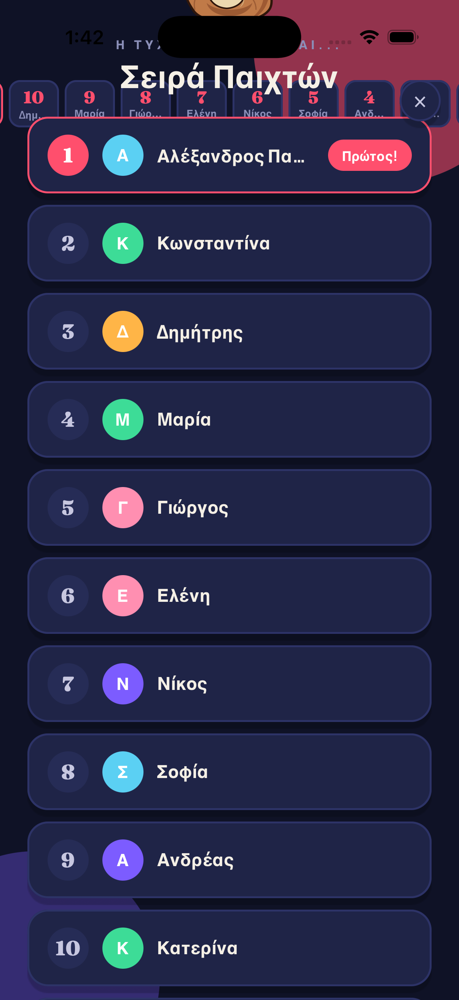
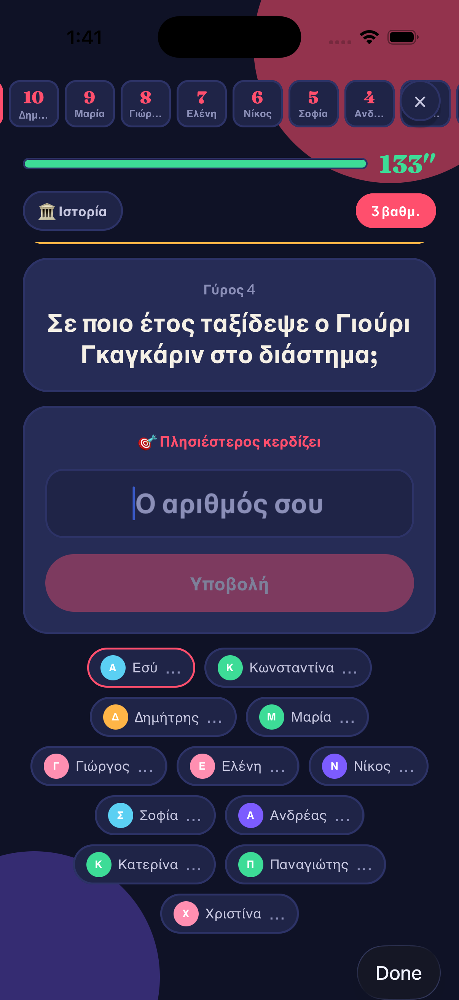
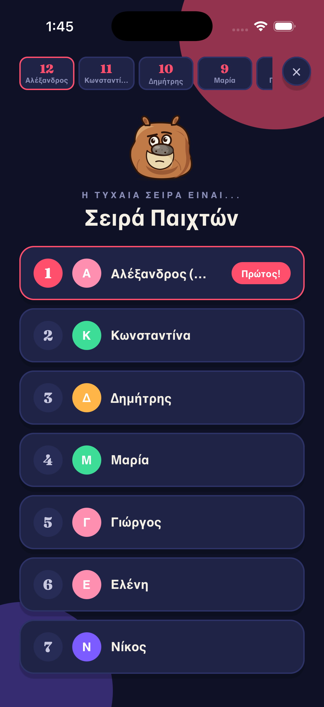
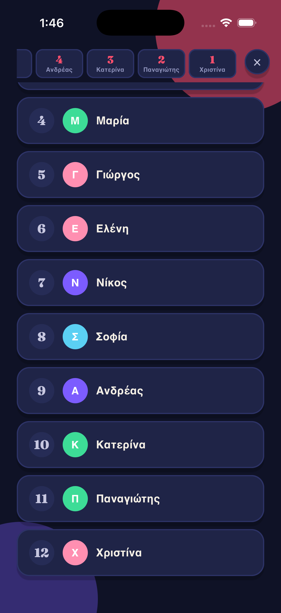

# Quiz screenshot audit — 5 September 2026

Environment: iPhone 17 simulator, iOS 26.5, Expo Go SDK 54. Portrait, default text size.

## Findings

### P2 — Turn order overflows with twelve players

The mascot and heading extend into and above the status bar; players 11 and 12 are below the viewport. Scrolling does not reveal them. Reproduced using the real TurnRevealScreen with a local twelve-player fixture.

Cause: `src/screens/TurnRevealScreen.tsx` renders all player rows in a vertically centered, non-scrolling View. Each row has a 36-point avatar plus vertical padding; twelve rows exceed the available height.

Suggested fix: keep the scoreboard separate and put the reveal content in a ScrollView, with content aligned from the top when it exceeds the viewport.

### P2 — Full-lobby scoreboard loses players off both screen edges

With twelve players, the solo scoreboard shows only the middle portion of the standings. The winner and the current player can both be offscreen. The close button also covers the rightmost visible score. Reproduced in Turn Reveal and Question using local fixtures.

Cause: `src/components/ScoreRow.tsx` lays every player in one centered View; each box has minWidth 44 and gaps are 5. Twelve boxes require at least 583 points before screen padding. There is no horizontal scrolling or wrapping.

Suggested fix: make the scoreboard horizontally scrollable, or use a compact expandable standings control; reserve space for the leave button.

### P2 — Status bar is difficult to read

Time, network, and battery indicators render black against the dark navy background. Observed during the live flow, starting at Home and continuing through the game screens.

`app.json` forces a light system appearance; App.tsx does not explicitly set a light-content status bar. Set the status-bar icon style explicitly and verify it across navigation transitions.

## Coverage

All ten screen components were captured and visually inspected in the conversation:

| Screen | Method and checks |
|---|---|
| Home | Live app; blank name disables actions, entering a name enables them |
| Join Game | Live app; empty six-character code and disabled join action |
| Create Game | Live backend; game created and invitation QR/code displayed |
| Lobby | Live backend; one-player guard, target changed to 10, Solo Test starts |
| Turn Reveal | Live one-player flow; local twelve-player overflow fixture |
| Turn | Live difficulty and category selection stages |
| Question | Live choice questions including long answer text; local numeric/team leader layouts and keyboard scrolling |
| Result | Live correct answers, Double earns six points, next-round navigation |
| Winner | Live completed game at ten points; standings, series tally, history; scrolling reveals rematch button |
| Loser | Local twelve-player finished-game fixture with a different winner |

The two PNG files alongside this report preserve the overflow findings. Other captures were inspected inline in the conversation.

## Scope and limits

The live match used the existing Solo Test control and completed three rounds (6 + 3 + 1 points). The rematch button was located by scrolling but was not pressed. Sample states were used for the loss screen, large roster, and team/numeric layouts; those are visual checks, not verification of multiplayer synchronization or team scoring. Fixture timers were deliberately extended, so the >30-second numbers in fixture screenshots are not a reported timer bug.

Camera/QR scanning, real multi-device play, Android, iPad, accessibility text scaling, and all error/power-up permutations were not exercised. The visible Solo Test button is already documented as a development-only release item.

Editing the shared game hook during fixture setup triggered a Fast Refresh subscription error; a full reload resolved it. This is excluded from the three product findings because it occurred during audit instrumentation.

Temporary fixture changes were removed and the original app, navigation, and hooks restored. No production code fixes were made during the initial audit. See the follow-up below.

## Fix verification — 5 September 2026

All three findings are now fixed. Turn Reveal uses a vertical ScrollView; the scoreboard uses horizontally scrollable cards with room reserved for the leave button; global and route-level status-bar icons use the light style.

Verified on the same simulator using a temporary twelve-player fixture. The initial title is fully visible; scrolling reaches players 11 and 12; horizontal scrolling reaches the final scorecards without overlapping the leave button. Temporary fixture code was removed afterward.

Validation: `npx tsc --noEmit` passed; `npx jest --roots=src --runInBand --silent` passed all 146 tests across 14 suites; `git diff --check` passed.
